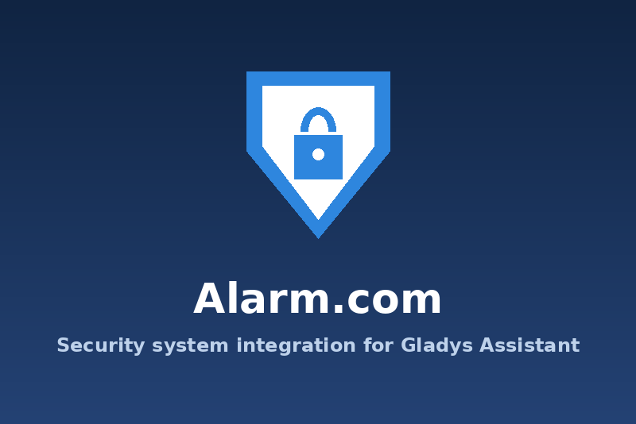

# Alarm.com for Gladys Assistant



An external integration for [Gladys Assistant](https://gladysassistant.com)
that controls **Alarm.com** security systems: arm and disarm partitions,
follow door/window, motion, water, smoke, CO and glass break sensors, and
drive locks, garage doors, lights and thermostats.

- **Cloud** integration (Alarm.com account, Internet access needed).
- Two-factor authentication supported (app, SMS, email).
- Scene triggers, scene actions and dashboard widgets (Gladys 5.1+).
- English, French, German and Spanish.

User documentation: [English](docs/en.md) · [Français](docs/fr.md) ·
[Deutsch](docs/de.md) · [Español](docs/es.md).

> Alarm.com offers no public API to end users: this integration uses the web
> API of the Alarm.com website. It is not affiliated with Alarm.com.

## Installation

Install it from the Gladys integration store (Integrations → Store), then
follow the [documentation](docs/en.md).

## Development

```bash
npm install
npm test
npm run lint
npm run format:check
```

Read [`CLAUDE.md`](CLAUDE.md) for the architecture and the project rules,
[`SECURITY.md`](SECURITY.md) to report a vulnerability, and
[`CHANGELOG.md`](CHANGELOG.md) for the changes.

## Release

GitHub → **Actions** → **Release** → _Run workflow_, choose `patch`, `minor`
or `major`. The workflow bumps the versions, rolls the changelog, tags,
publishes the multi-arch image on `ghcr.io` and the GitHub Release.

## License

Apache-2.0.
